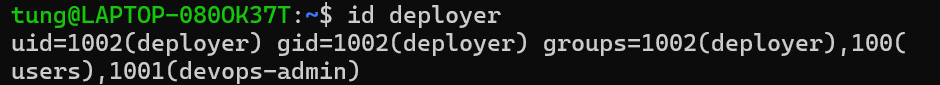
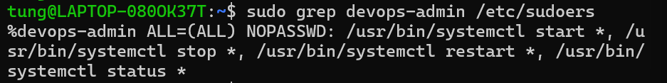
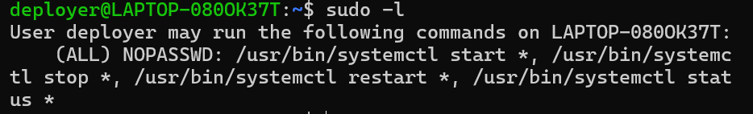
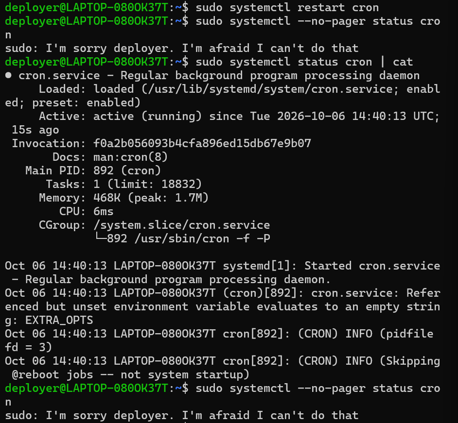

# Bài 2: Cấu hình phân quyền Nhóm và sudoers bằng visudo

## 1. Mục tiêu

- Tạo tài khoản người dùng (User) và nhóm (Group) mới trên Linux.
- Hiểu cơ chế hoạt động của đặc quyền quản trị `sudo` và tệp cấu hình `/etc/sudoers`.
- Phân quyền giới hạn cho một nhóm người dùng chỉ được thực hiện một số lệnh hệ thống nhất định.

## 2. Bối cảnh

Đội ngũ vận hành (Ops) cần cấp quyền khởi động lại (restart) các dịch vụ hệ thống cho nhân viên Deployer tự động hóa, nhưng không cấp toàn quyền root cho tài khoản này.

## 3. Ràng buộc

- Tạo nhóm `devops-admin`.
- Tạo user `deployer` và đưa vào nhóm `devops-admin`.
- Cấu hình `/etc/sudoers` cho phép nhóm `devops-admin` chạy `systemctl (start, stop, restart, status)` không cần mật khẩu (`NOPASSWD`).

## 4. Các bước thực hiện

### 4.1. Tạo nhóm và người dùng

```bash
sudo groupadd devops-admin
sudo adduser deployer
sudo usermod -aG devops-admin deployer
```

Kiểm tra lại nhóm của user:

```bash
id deployer
```

Kết quả mong đợi:

```text
uid=1001(deployer) gid=1001(deployer) groups=1001(deployer),1002(devops-admin)
```

### 4.2. Mở tệp sudoers an toàn bằng visudo

```bash
sudo visudo
```

### 4.3. Thêm quy tắc phân quyền cho nhóm

Thêm dòng sau vào cuối tệp `/etc/sudoers` (dấu `%` biểu thị cho Group):

```text
%devops-admin ALL=(ALL) NOPASSWD: /usr/bin/systemctl start *, /usr/bin/systemctl stop *, /usr/bin/systemctl restart *, /usr/bin/systemctl status *
```

Dòng cấu hình sudoers đã thêm vào hệ thống:

```text
%devops-admin ALL=(ALL) NOPASSWD: /usr/bin/systemctl start *, /usr/bin/systemctl stop *, /usr/bin/systemctl restart *, /usr/bin/systemctl status *
```

## 5. Kiểm tra

### 5.1. Chuyển sang tài khoản deployer

```bash
su - deployer
```

### 5.2. Kiểm tra các lệnh đặc quyền sudo được phép thực thi

```bash
sudo -l
```

Kết quả:

```text
Matching Defaults entries for deployer on <hostname>:
    env_reset, mail_badpass, secure_path=/usr/local/sbin\:/usr/local/bin\:/usr/sbin\:/usr/bin\:/sbin\:/bin

User deployer may run the following commands on <hostname>:
    (ALL) NOPASSWD: /usr/bin/systemctl start *, /usr/bin/systemctl stop *, /usr/bin/systemctl restart *, /usr/bin/systemctl status *
    (ALL : ALL) ALL
```

### 5.3. Chạy thử lệnh khởi động lại dịch vụ hệ thống

```bash
sudo systemctl restart cron
```

Kết quả: lệnh chạy thành công, không yêu cầu nhập mật khẩu của user `deployer`.

Kiểm tra thêm trạng thái dịch vụ:

```bash
sudo systemctl status cron
```

## 6. Minh chứng

### Ảnh 1: Tạo nhóm và user, kiểm tra `id deployer`



### Ảnh 2: Dòng cấu hình trong `/etc/sudoers`



### Ảnh 3: Kết quả `sudo -l` của user `deployer`



### Ảnh 4: `sudo systemctl restart cron` không cần mật khẩu


